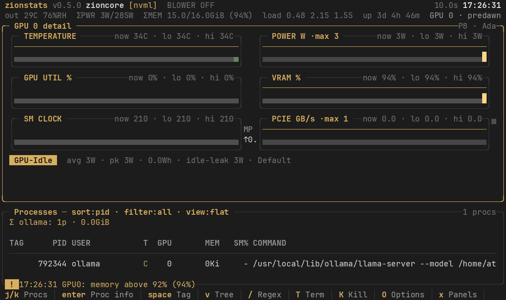

# zionstats

[](https://github.com/athulkrishnan/zionstats/actions/workflows/ci.yml)
[](LICENSE)
[](#why-graphs-look-like-btop)
[](pyproject.toml)

A btop-grade GPU monitor **built for the local-LLM rig**: which process is
eating your VRAM (Ollama, llama.cpp, vLLM), what inference does to your
thermals and power, and automatic cooling when it matters. Dense, colorful,
insight-first.



**Monitoring a local LLM right now?** Start
[here](docs/MONITORING-OLLAMA.md) -- per-process VRAM and SM% for
llama-server/vLLM, what the verdict chips mean during inference, and the
Prometheus/Grafana fleet view.

**v0.5.0 — Process forensics + btop-grade UX + built-in Prometheus exporter**:
a selectable/tree/detail process explorer with safe signal delivery, full
mouse support, an in-TUI options menu, layout presets, and a stdlib-only
Prometheus endpoint with a ready-made Grafana dashboard.

zionstats watches your NVIDIA GPUs the way btop watches your CPU: full-canvas
TUI, gradient braille graphs, block bars, rounded panels, 16 built-in themes,
and a researcher-grade metric layer on top of NVML -- throttle reasons, clock
deficit, PCIe saturation, session energy, per-process GPU utilization, and a
live verdict chip (`COMPUTE-BOUND`, `POWER-LIMITED`, `THERMALLY-LIMITED`,
`MEMORY-BOUND`, `IDLE`).

One dependency (`nvidia-ml-py`). Stdlib curses renderer with a diff-flush
cell buffer, so it stays crisp over SSH, in tmux splits, and in iTerm2.


## Highlights

- **Process forensics** (v0.4.0) -- selectable, scrollable process table;
  tree view with /proc parent chains; per-process detail screen (full
  cmdline, cwd, exe, environment, live SM% sparkline); tag/untag; SIGTERM /
  SIGKILL behind a typed `yes` confirmation, `--readonly`, and hard
  demo/replay blocks.
- **btop-grade UX** (v0.4.0) -- full mouse support (click cards, keyhints,
  rows, menus; wheel scrolls), in-TUI options menu with live-apply +
  persistence, panel toggles, named layout presets with one-key hotkeys,
  auto-scaling graphs.
- **Built for local LLMs** -- [Monitoring Ollama guide](docs/MONITORING-OLLAMA.md):
  what each metric means during inference, per-process VRAM for
  llama-server/vLLM, fleet Grafana.
- **Built-in Prometheus exporter + Grafana dashboard** (v0.4.0) --
  `--export [HOST:]PORT` serves `/metrics` and `/snapshot` from the same
  process (stdlib only, no prometheus_client); ships a ready-made Grafana
  board.
- **Climate-aware** (v0.3.0) -- keyless global weather, dew-point/wet-bulb
  physics, cooling-effectiveness index, and optional fail-safe smart-plug
  blower automation (see below).
- **Verdict chip per GPU** -- the app tells you what your workload is:
  compute-bound, memory-bound, power-limited, thermally-limited, or idle,
  derived from utilization split + NVML throttle-reason bitmask.
- **Full NVML 13 coverage** -- GPU/mem/encoder/decoder utilization, VRAM +
  reserved + BAR1, power draw/limits/range, SM/mem/video clocks vs max,
  decoded throttle reasons (SW-Power-Cap, HW-Slowdown, SW-Thermal, ...),
  temps + slowdown/shutdown thresholds + dT/dt trend, fans, PCIe
  gen/width/throughput with saturation %, ECC SBE/DBE, MIG, modes.
- **Session energy** -- integrates the NVML millijoule counter into Wh,
  plus average/peak power and idle-leak watts (draw at <5% util).
- **Per-process GPU utilization** -- pmon-class per-PID SM/ENC% via the
  NVML process-utilization API, merged with /proc for user + command +
  CPU%, with a per-user rollup row for shared boxes.
- **Alerts** -- edge-triggered strip: hardware throttle engaged/cleared,
  within 5C of slowdown, VRAM > 92%, uncorrected ECC.
- **16 themes, live preview picker** -- press `t`: arrow through swatches,
  the whole UI re-skins live; Enter keeps it, Esc reverts. Themes: predawn
  (default), solarized-dark, gruvbox, nord, dracula, catppuccin-mocha,
  tokyo-night, synthwave-84, cyberpunk, everforest, rose-pine, one-dark,
  matrix, amber-crt, btop-classic, paperwhite.
- **Record / replay / snapshot / log** -- capture a gzipped ndjson trace
  and replay it later in the full TUI; one-shot JSON for scripts; headless
  jsonl logging for regression tests; `--doctor` environment check.
- **Batched sampling** -- one NVML FieldValues call per GPU per tick for
  the hot metrics (energy counter, power, clocks, utils), individual
  getters as fallback; graceful per-metric degradation on GeForce
  (no ECC/MIG? those fields just hide).
- **Layouts that fit your terminal** -- hero (single GPU, big graphs +
  detail), grid (2-8 GPUs), compact (<110 cols, split-pane friendly);
  auto-switched, or forced with `l`. Verified at 90x25 through 300x80.

## Building from source

Everything builds with the standard toolchain — no cross-compilation needed
because the wheel is pure Python (works on any OS/arch), and binaries are
built natively per-platform by CI.

```bash
# 1) universal wheel + sdist  ->  dist/
pip install build && python -m build

# 2) self-contained binary (build on the OS/arch you target)
pip install .[dev] pyinstaller
pyinstaller --onefile --name zionstats --clean -y run.py
#    -> dist/zionstats (linux/macOS) or dist\zionstats.exe (windows)
```

**Releases are automated**: pushing a tag (`git tag v0.3.0 && git push --tags`)
triggers GitHub Actions to build the wheel, sdist, and native binaries for
`linux_amd64`, `linux_arm64`, `macOS_amd64`, `macOS_arm64`, `windows_amd64`,
sha256 them into `checksums.txt`, and attach everything to the GitHub Release
(see `.github/workflows/release.yml`). Local builds and CI builds use the
exact same entry point (`run.py`).

Optional extras: `pip install .[plugs]` (tinytuya + python-kasa for smart
plugs), `pip install .[dev]` (build + pyinstaller).

## Climate + blower automation (optional)

The weather layer is on by default (one keyless request per 20 min, cached to
disk, offline-tolerant — set `[weather] enabled = false` for zero network).
It shows ambient temperature, humidity, dew point, wet-bulb, a 24 h outlook,
and the honest part: a **BLOWER VALUE** index — how much a fan blowing outside
air at your GPU is actually worth right now (`(Tgpu − Tamb)` headroom, derated
by humidity). It also warns when a surface sits below the dew point
(condensation — cold AC room, muggy monsoon night: keep the blower off).

The cooling automation is **off until you turn it on**:

```toml
[cooling]
enabled = true
mode = "dry_run"        # off | dry_run | auto | manual  -- start with dry_run
trigger = "usage"       # usage | temp
usage_util = 5.0        # (usage) GPU util % that counts as "in use"
idle_off_s = 600        # (usage) OFF after this many idle seconds AND below resume_temp
trigger_temp = 82.0     # (temp) blower ON at/above this GPU temp ...
resume_temp = 78.0      # ... and OFF again at/below this (hysteresis / hot-guard)
min_delta_c = 8.0       # (temp) only bother if GPU is >= 8C over ambient
min_on_s = 120          # no flapping
min_off_s = 180
max_duty_min = 90       # forced cooldown after 90 continuous minutes

[[cooling.plugs]]
backend = "tuya"        # tuya | kasa | shelly | tasmota | ha | mock
name = "blower"
id = "..."; address = "192.168.1.50"; key = "..."; version = 3.3
```

**Two triggers.** `trigger = "usage"` turns the blower ON the moment GPU
utilization crosses `usage_util`, and OFF once the GPU has stayed idle for
`idle_off_s` **and** cooled below `resume_temp` — a hot-idling GPU after a
load spike keeps its blower until it is actually cool (the hot-guard only
extends an ON, it never starts one). `trigger = "temp"` is the original
temperature-hysteresis behavior: ON at `trigger_temp` with `min_delta_c` over
ambient, OFF at `resume_temp`.

In `dry_run` zionstats decides, logs and shows `DRY-RUN: blower would be ON`
without touching anything — watch it for a day, then flip `mode = "auto"`.
Keys: `w` climate panel · `o` manual blower toggle · `c` cycle mode.

**Headless.** The automation does not need the TUI: `zionstats --log
gpu.jsonl` runs the same fail-safe controller (systemd-unit friendly) and
prints every blower event to stderr (`zionstats blower [on] usage 40% >= 5%`).

**Failsafes** (auto mode): GPU samples stale > 15 s force the blower OFF in
every actuating mode; stale weather (> 45 min) force-off applies to the
`temp` trigger only (usage mode never reads weather); minimum on/off times
prevent relay chatter; 90 min continuous duty forces a cooldown; every
command is verified by readback and retried twice before an alert fires.

**Plug setup** — the plugs stay paired with Alexa/Google exactly as they are
(voice still works); zionstats drives them locally on your LAN, so automation
works with the internet down and no cloud sees your data:

| backend | needs | notes |
|---|---|---|
| `tuya` | `pip install tinytuya` + one-time `python -m tinytuya wizard` for the local key | most Alexa-compatible plugs are Tuya |
| `kasa` | `pip install python-kasa` | TP-Link plugs |
| `shelly` | nothing | Gen1/Gen2 REST, config `gen = 1|2` |
| `tasmota` | nothing | stock HTTP endpoint |
| `ha` | Home Assistant long-lived token | the hub route: Alexa → HA → anything |

Verify hardware while awake: `zionstats --plug-test "blower on"` → `blower: ON`.
`zionstats --doctor` reports weather reachability, plug reachability, and
flags loudly when AUTO is armed.

**Tested hardware**: Zebronics ZEB-SP110 (10A, Tuya firmware v3.4) — verified
end-to-end: local ON/OFF with readback, `--plug-test`, and a full
usage-triggered automation cycle in both dry-run and auto. Any Tuya-based
plug that pairs with a Tuya app should behave the same way.

> Safety: this feature switches mains devices. zionstats ships it disabled,
> recommends dry-run first, force-offs on stale telemetry, and never touches
> real plugs in `--demo`.

## Process forensics (v0.4)

The process table is a full explorer -- and for LLM work it resolves
`llama-server`, `vllm`, and `llama-cli` to their actual VRAM, SM%
utilization and command lines. UI concepts follow nvitop; the
implementation is original (see Credits).

```
up/down or j/k   move              enter  detail screen
pgup/pgdn        page              space  tag / untag
home/end         first / last      v      tree <-> flat
/                regex filter      T      SIGTERM (type "yes")
s                cycle sort        K      SIGKILL (type "yes")
```

- **Tree view** (`v`) splices each process's /proc parent chain above it
  (`sshd -> bash run.sh -> python train.py`), so you can see *who launched*
  the GPU hog.
- **Detail screen** (Enter) shows the full command line, cwd, exe, ancestor
  chain, the process environment (scroll with j/k), and a live SM%
  sparkline from the NVML per-process metrics.
- **Signals** (`T`/`K`) require typing `yes` — no accidental kills — and are
  refused outright under `--readonly` (or `readonly = true` in the config),
  in `--demo`/`--replay`, and without a live NVML provider. On Windows,
  SIGTERM is delivered by the OS as a hard terminate; the confirmation and
  `--readonly` guard are the safety rails there.
- **Regex filter** (`/`) matches user, command, or PID (case-insensitive),
  composes with `f` (show only my processes), and persists to the config.

## Prometheus exporter + Grafana (v0.4)

Monitoring a local-LLM box headless? This is the fleet view. One flag
turns the monitor into a scrape target — no second process, no
extra package (the idea is credited to nvitop-exporter; the implementation
is stdlib `http.server`):

```bash
zionstats --export 127.0.0.1:9835     # or [export] enabled = true in config
#   GET /metrics    Prometheus text format (typed families, counters for energy/ECC)
#   GET /snapshot   live JSON (same shape as --snapshot)
```

- Default bind is **127.0.0.1**; the HTTP thread never touches NVML, so
  scraping cannot disturb sampling. Metrics appear after the first tick.
- Metric names are `zionstats_gpu_*` / `zionstats_process_*` with
  `{gpu, name, uuid}` labels; the default port 9835 matches nvitop-exporter,
  so a board built for it works unchanged.
- **Grafana**: import [`dashboards/zionstats-prom.json`](dashboards/zionstats-prom.json)
  (utilization, VRAM, power-vs-limit, temperatures, clocks, PCIe, energy
  rate + session Wh, throttle state-timeline, top-processes table).
- Headless mode composes: `zionstats --log run.jsonl --export :9835`.
- Security: no auth by design — keep the loopback bind on shared hosts, and
  set `[export] expose_processes = false` if PIDs/usernames/cmdlines are
  sensitive in your environment (see [SECURITY.md](SECURITY.md)).

## Presets, panels, mouse (v0.4)

- **Options menu** (`O`) — every setting (interval, theme, graph style,
  layout, sort, filters, units, auto-scale, mouse, readonly) in one overlay;
  cycles apply live and persist to the config, exactly like the direct keys.
- **Panels** (`x`) — toggle detail / climate / alerts / processes
  (btop-style box toggling); state is saved.
- **Presets** (`P`) — named bundles of layout + theme + graph style +
  interval + visible panels:

  ```toml
  [presets.focus]
  layout = "compact"
  graph_style = "ascii"
  interval = 0.5
  panels = ["procs"]      # optional; keys: detail climate alerts procs
  key = "Z"               # optional one-key hotkey (unbound keys only)
  ```

- **Mouse** — click a GPU card to select it, click the key-hint bar to press
  those keys, click process rows (double-click opens the detail screen),
  wheel scrolls the list. All menus are click-navigable. Disable with
  `mouse = false`. In tmux, `set -g mouse on` lets clicks through.

## The Rust core: zionstatsd + SHM-backed TUI (v0.5, preview)

> The Rust workspace now lives canonically at
> [zionstats-rs](https://github.com/athulkrishnan/zionstats-rs) (v0.6+:
> one-command demo, calibrated 4 Hz TUI, `--check-config`, completions,
> criterion benches, published benchmarks). `crates/` here is a frozen
> v0.5 mirror kept for this repo's CI.

v0.5 adds a Rust re-architecture beside the Python TUI (the Python app above
is unchanged and stays fully supported):

- **`zionstatsd`** -- an always-on systemd daemon (`Type=notify`, watchdog)
  that polls NVML at up to **4 Hz** (`interval = 0.25`), publishes a
  zero-copy **shared-memory** frame (`/dev/shm/zionstats-<uid>`, 0600,
  seqlock-protected), runs the same fail-safe **blower automation** as the
  Python daemon (Shelly + Tasmota natively; Tuya stays on
  `zionstats --log` for now), optionally drives **GPU fan PWM** through
  NVML (opt-in: `[daemon] fan_control = true`; the daemon probes writability,
  restores driver control at startup and on exit, and nvml's own warning
  applies: setting fan speeds too low can burn the GPU), and serves
  **Prometheus metrics + JSON snapshot on :9400** with the same
  `zionstats_gpu_*` families as the Python exporter plus DCGM-style labels.
- **`zionstats-tui`** -- an ephemeral terminal UI that attaches to the
  daemon's shared memory and never touches NVML itself: instant start,
  LIVE/STALE/DAEMON-DOWN badges, GPU cards with sparklines, process table
  (with docker/k8s pod attribution resolved by the daemon), alerts strip.

```bash
cargo build --release --workspace
sudo ./packaging/install.sh            # bins + systemd unit + /etc/zionstats
sudo systemctl enable --now zionstatsd
zionstats-tui                          # attach (or: zionstats)
curl 127.0.0.1:9400/metrics            # Prometheus
```

Try it without installing or a GPU: `zionstatsd --demo` then `zionstats-tui`.
The daemon refuses to start twice (flock) so it can never fight the Python
`zionstats --log` blower controller over the same plug. GPU fan control and
plug automation ship **off**; `--readonly` builds no actuators at all.

## Install

```bash
pip install zionstats                                  # from PyPI
pip install git+https://github.com/athulkrishnan/zionstats.git
pip install .                                          # from a checkout
./bin/zionstats                                        # without installing
```

Or grab a self-contained binary from
[Releases](https://github.com/athulkrishnan/zionstats/releases) (bundled
Python, no interpreter needed) — `linux_amd64`, `linux_arm64`,
`macOS_arm64`, `windows_amd64`, each with a `checksums.txt`.
macOS Intel and other platforms: `pip install` from source runs anywhere
Python 3.9+ does.

| Platform | Live NVML metrics | Notes |
|---|---|---|
| Linux | yes (primary target) | NVIDIA driver 5xx+ |
| Windows | yes | `windows-curses` auto-installed with pip; binaries bundle it |
| macOS | demo mode | NVIDIA dropped modern macOS drivers; TUI + `--demo` work |

Requires an NVIDIA GPU with driver 5xx+ for live metrics; `--demo` works
anywhere.

## Usage

```bash
zionstats                     # the TUI
zionstats --demo              # synthetic 2-GPU trace (theme dev, no GPU needed)
zionstats --theme gruvbox     # pick a theme
zionstats --only 0            # watch specific GPUs
zionstats -1                  # one-shot text summary
zionstats --snapshot          # one-shot JSON
zionstats --record trace.ndjson.gz --duration 60
zionstats --replay trace.ndjson.gz     # replay in the full TUI
zionstats --log run.jsonl     # headless logging until Ctrl-C
zionstats --log run.jsonl --export :9835   # headless + Prometheus
zionstats --export 127.0.0.1:9835         # TUI + scrape target
zionstats --readonly          # disable process signals
zionstats --doctor            # environment health check
zionstats --location 51.5,-0.13,London    # weather anywhere on Earth
zionstats --plug-test "blower on"         # verify a plug safely
zionstats --list-themes
```

Environment: `ZION_CONFIG` relocates the config file; `NO_COLOR` drops all
color (bold kept).

## Keys

```
j/k or up/down move procs     enter  process detail     space  tag
v tree/flat    / regex        T SIGTERM              K SIGKILL
O options      x panels       P presets              1-9/<-> select GPU
q quit         t theme picker m cycle theme          d detail
w weather      o blower       c cool mode            a blower auto
p pause        r reset stats  s sort procs           f filter me
F Fahrenheit   b paint bg     l layout               +/- rate
? help
```

`a` is the one-press automation switch: AUTO watches GPU usage and runs the
blower from load start until 10 minutes after idle (extended while the GPU
is still hot); pressing it again disarms to `off`.

## Why "the researcher layer"

Raw utilization is half the story. A GPU pinned at 100% while drawing its
full power envelope is *power-limited* -- you are leaving clocks on the
table and your training throughput is throttled by the cap, not by your
batch size. zionstats surfaces that distinction the moment it happens:
the verdict chip flips, `SW-Power-Cap` lights up, the power bar saturates,
the clock-deficit counter shows exactly how many MHz below max you are
running, and an alert fires once -- not spam -- until the state clears.

## Security notes

- The config file (`~/.config/zionstats/config.toml`) can hold plug secrets
  (Tuya local keys, Home Assistant tokens). It is written with `0600`
  permissions -- keep it that way if you edit by hand. `ZION_CONFIG`
  relocates it.
- The weather layer is the **only** outbound network call (keyless HTTPS to
  Open-Meteo, cached, and fully disableable with `[weather] enabled = false`
  or `--no-weather`). Plug control is LAN-only; nothing is sent to any cloud.
  The optional metrics exporter **listens** (loopback by default) -- see
  [SECURITY.md](SECURITY.md) for what it exposes.
- No telemetry, no accounts, no eval/subprocess anywhere in the codebase.
- Cooling automation ships **disabled** and `dry_run` is the recommended
  first mode; `--demo` structurally cannot touch real plugs.
- Process signals (`T`/`K`) need a typed `yes`; `--readonly` disables them
  entirely; `--demo`/`--replay` hard-block them.

## Contributing

Issues and PRs welcome. Development loop:

```bash
pip install -e . && pip install ruff mypy
python tests/test_*.py        # each file runs standalone, no GPU needed
ruff check . && mypy zionstats
zionstats --demo              # everything interesting, no GPU needed
```

Please keep new backends local-first (no cloud calls), keep every feature
working with `--demo` so screenshots and CI stay hardware-free, and keep the
runtime stdlib-first (only `nvidia-ml-py` may be imported unconditionally).
Releases publish to PyPI via trusted publishing (OIDC) — maintainers need a
one-time "trusted publisher" entry on PyPI for this repo/workflow.

## FAQ

**Does it work with multiple GPUs?** Yes -- hero/grid layouts scale to 8+
cards; cards tile and the verdict engine runs per GPU.

**Does it need a GPU?** No. `zionstats --demo` runs a synthetic two-GPU
scenario (including a scripted thermal-throttle arc and a mock blower) for
theme development, screenshots, and CI.

**Graphs look like dots / broken?** Graphs default to the btop rendering
engine — quadrant transition glyphs (`▗▟█`) with per-row gradient shading,
ported from btop's `btop_draw.cpp` — solid in every monospace font. Other
styles via `graph_style = block | tty | braille | ascii` (braille needs a
DejaVu/JetBrains-class font; ascii is bulletproof). Terminals exposing fewer
than 256 colors automatically degrade the palette to base 16 (`zionstats
--doctor` reports what your terminal detected).

**Why not just talk to Alexa directly?** Amazon offers no consumer local
API for Alexa, and cloud round-trips are both fragile and a privacy cost.
Your plugs stay paired with Alexa for voice; zionstats drives them over the
LAN so automation works offline.

**Is the blower feature safe?** It switches mains devices, so it ships off,
recommends dry-run first, force-offs on stale telemetry, duty caps, and
readback verification. See the cooling section above.

**My Tuya plug won't pair.** These plugs are 2.4 GHz-only — if your router
merges bands, split the SSIDs (or use the app's AP-mode fallback: fast-blinking
LED, connect the phone to the plug's hotspot).

**`tinytuya wizard` can't find my devices / the app won't link.** Brand apps
(Zeb Home, and most other whitelabel Tuya apps) cannot be linked to your own
iot.tuya.com project — only Tuya Smart and Smart Life can. Factory-reset the
plug and pair it with **Tuya Smart** or **Smart Life** (pick your real country
at registration — devices live in that data center), create the cloud project
with the *same* data center, then run `python3 -m tinytuya wizard -region in`
(`-region` options: `cn, us, us-e, eu, eu-w, in, sg`). The cloud is used once,
to read the local key; runtime stays 100% LAN-local.

**`--plug-test` prints UNKNOWN.** Some firmwares don't expose a readable
switch DP; status readback returns "no readback support" and plug-test exits 1
on `status`. Automation still works — the controller's write + verify loop
treats an unreachable readback as success and retries on disagreement.

**I re-paired my plug and zionstats lost control.** The Tuya local key
rotates on every pairing. Re-run the wizard and update `key` in the plug's
config entry.

**Can it run without the TUI (e.g. while gaming)?** Yes — `zionstats --log
gpu.jsonl` runs the same fail-safe blower controller headless and prints every
event to stderr. A minimal systemd user unit:

```ini
[Unit]
Description=zionstats blower automation
After=network-online.target

[Service]
ExecStart=%h/.local/bin/zionstats --log %h/gpu.jsonl
Restart=on-failure

[Install]
WantedBy=default.target
```

## Status & disclaimer

zionstats was hacked together in under two days, hackathon-style. It works
well on the author's rig — and nowhere else is guaranteed. Expect bugs. The
software is provided **as-is, without warranty of any kind**; the author is
**not liable** for any damages, data loss, or burnt-down houses (the binding
legal text is Apache-2.0 §7 and §8 in [LICENSE](LICENSE) — this section is
just the human version). The blower feature switches **mains-voltage
devices**: test with `--plug-test` while awake, stay in `dry_run` until you
trust it, and never automate a load that is unsafe to switch. zionstats is
not affiliated with NVIDIA, Zebronics, Tuya, or any plug vendor; all product
names and trademarks belong to their respective owners.

## Credits and prior art

zionstats stands on the shoulders of the tools that defined this genre.
License compliance is deliberate: Apache-2.0 code is ported with attribution
headers and a [NOTICE](NOTICE) file; GPL-licensed code is never copied —
features are clean-room reimplementations from public behavior.

- **[btop](https://github.com/aristocratos/btop)** (Apache-2.0) — the design
  language and the graph engine: the quadrant-transition renderer is ported
  from `btop_draw.cpp` with per-row gradient shading; options menu, mouse
  interaction, box toggling, and presets follow btop's UI concepts.
- **[nvitop](https://github.com/XuehaiPan/nvitop)** (API: Apache-2.0;
  TUI/CLI: GPL-3.0) — the project that inspired this one. The `NaType`
  safe-arithmetic sentinel is ported from the Apache-2.0 `nvitop/api`
  layer; the TTL-cache pattern follows its use of `cachetools` (ours is an
  original stdlib implementation); the process tree, tagging, and
  kill-confirmation UX are clean-room reimplementations — no GPL code used.
- **[nvitop-exporter](https://github.com/XuehaiPan/nvitop)** — the embedded
  metrics-endpoint + Grafana dashboard idea (our implementation is stdlib;
  port 9835 matches for drop-in compatibility).
- **[nvtop](https://github.com/Syllo/nvtop)** (GPL-3.0, ideas only) and
  **[gpustat](https://github.com/wookayin/gpustat)** — layout and process
  listing inspiration.
- **[all-smi](https://github.com/lablup/all-smi)** — record/replay, JSON
  snapshots, doctor, provider abstraction.
- **[gputop](https://github.com/rib/gputop)** — headless machine-readable
  logging heritage.

### How zionstats compares (honest table)

|  | zionstats | btop | nvitop | nvtop |
|---|---|---|---|---|
| NVIDIA metrics depth | full NVML 13 + energy + pmon | good | full | good |
| Process tree / detail / env | yes | n/a (CPU procs) | yes | partial |
| Signals with confirm + readonly | yes | yes (CPU) | yes | partial |
| Mouse | yes | yes | yes | partial |
| Options menu / presets | yes | yes | env-vars only | setup window |
| Prometheus + Grafana built-in | yes | no | separate pkg | no |
| Multi-vendor (AMD/Intel) | planned v0.5 | yes | no | yes |
| Climate / condensation / blower automation | unique | no | no | no |
| Verdict chips + alerts + session energy | unique | no | partial | no |
| Record / replay / headless log | yes | no | partial | no |
| Runtime deps | 1 (nvidia-ml-py) | none (C++) | nvidia-ml-py, psutil, cachetools | none (C++) |

All four tools are excellent; zionstats aims to be the best *NVIDIA-first,
insight-first* option — vendor breadth is the known v0.5 gap.

## License

Apache-2.0 -- see [LICENSE](LICENSE). The Apache license was chosen for
its explicit patent grant, which matters for a tool that interfaces with
hardware control paths.
